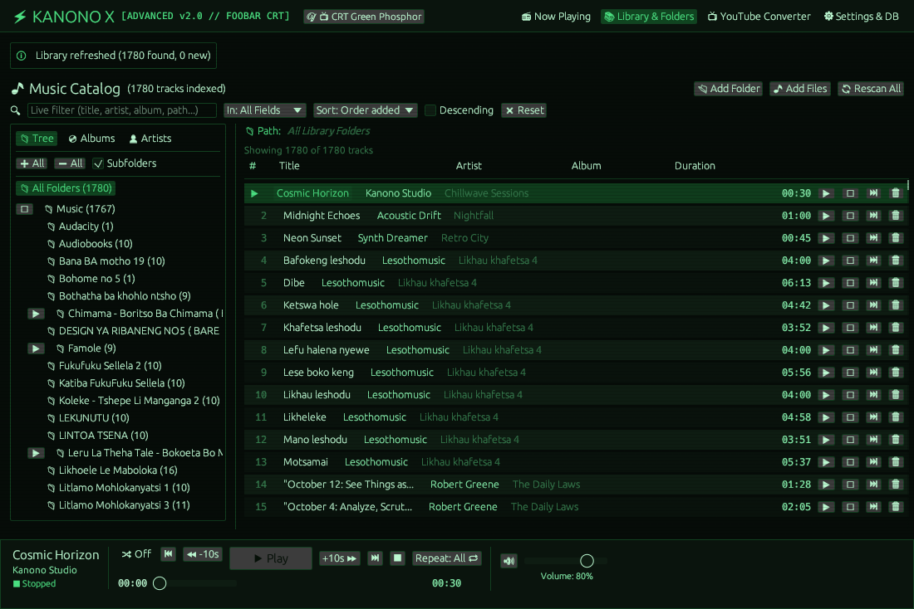
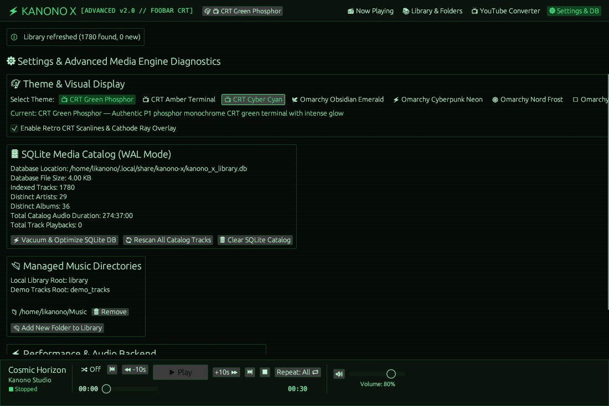
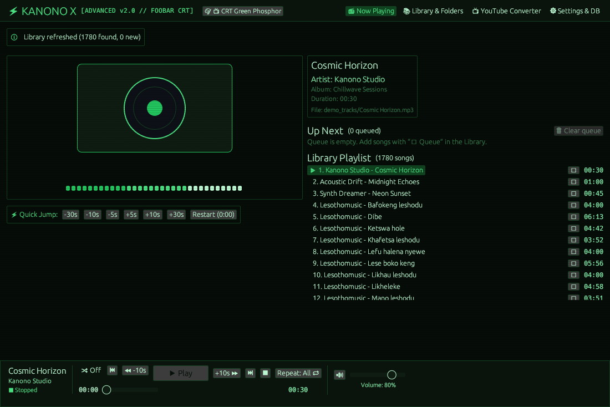

# Kanono X


**Kanono X** is a Linux desktop audio player and local music library manager written in Rust. It combines a fast `egui` interface with Foobar2000-style folder navigation, a SQLite-backed catalog, configurable CRT and Omarchy-inspired themes, legal Audius streaming, and opt-in user-configured external providers.

[](https://github.com/majortank/kanono-x/actions/workflows/ci.yml)
[](LICENSE)

> **Status:** Kanono X is an early release (`0.2.0`). Core playback, library scanning, filtering, themes, and catalog management are usable, while platform packaging and some playback edge cases are still evolving.

## Features

- **Local playback** with play/pause, seeking, volume, mute, track navigation, and a 32-band visualizer.
- **Foobar-style library navigation** with a hierarchical folder tree, breadcrumbs, expandable folders, and an include-subfolders toggle.
- **Fast filtering and sorting** across title, artist, album, filename, and folder path.
- **SQLite catalog** using WAL mode, indexed metadata queries, play counts, rescan support, and maintenance tools.
- **Eight visual themes:** CRT Green, CRT Amber, CRT Cyber Cyan, Omarchy Emerald, Cyberpunk, Nord, Dracula, and Solarized.
- **Legal discovery and streaming** through the public Audius API, with downloads gated by the artist's `is_downloadable` flag.
- **Generic external providers** loaded from `~/.config/kanono-x/providers.toml`; no media service is hardcoded into the core.
- **Artist support links** extracted from Audius profiles and local audio tags and opened in the system browser.
- **Headless screenshot mode** for UI checks and automated visual capture.

### Supported audio formats

The library scanner recognizes MP3, WAV, FLAC, OGG, M4A, AAC, and Opus files. Actual playback support depends on the codecs available through the selected `rodio` backend.

## Screenshots

| Library and folder tree | Settings and catalog tools |
|:---:|:---:|
|  |  |

| Now playing |
|:---:|
|  |

## Requirements

- Linux with a working audio device
- Rust and Cargo (Rust 1.75 or newer recommended)
- ALSA development libraries
- FFmpeg is optional and only needed by external provider commands that you configure

### Debian/Ubuntu

```bash
sudo apt install build-essential pkg-config libasound2-dev
sudo apt install ffmpeg  # optional provider dependency
```

### Arch Linux

```bash
sudo pacman -S base-devel pkgconf alsa-lib
sudo pacman -S ffmpeg  # optional provider dependency
```

## Build and run

```bash
git clone https://github.com/majortank/kanono-x.git
cd kanono-x
cargo run --release
```

The application scans `~/Music` by default when it exists. Add additional folders from the **Library** tab. If no audio directory exists, downloaded audio falls back to the application's local data directory.

### Command-line options

```text
--tab <nowplaying|library|discover|providers|settings>
    Open a specific tab at startup.

--screenshot <path.png>
    Run in inactive/headless capture mode and save a screenshot.
```

Examples:

```bash
cargo run --release -- --tab library
cargo run --release -- --tab settings --screenshot /tmp/kanono-settings.png
```

## Local data

Kanono X currently stores its runtime data relative to the directory from which it is launched:

| Path | Purpose |
|---|---|
| `~/.local/share/kanono-x/kanono_x_library.db` | SQLite library catalog |
| `~/.local/share/kanono-x/kanono_x_library.db-wal` / `.db-shm` | SQLite WAL sidecar files |
| `~/.local/share/kanono-x/library_cache.json` | Cached local track metadata |
| `~/.local/share/kanono-x/library_state.json` | Saved library folders and files |
| `~/.config/kanono-x/providers.toml` | User-defined external provider commands |
| `~/Music` | Default music directory when present |

Do not commit personal music, generated databases, or cache files. The repository `.gitignore` already excludes these paths.

## Legal streaming and external providers

Audius search and streaming use the public Audius REST API. Kanono X only shows **Download to Library** when Audius marks a track as downloadable. External providers are entirely user-configured and execute only commands that the user has installed and authorized. Use every source according to its terms and applicable law.

On first launch, Kanono X creates a documented provider template at `~/.config/kanono-x/providers.toml`. Search commands should print tab-separated or newline-delimited JSON results; see the generated file for the supported placeholders and fields.

## Development

Format and check the project before opening a change:

```bash
cargo fmt --all -- --check
cargo check --locked
```

The main modules are:

```text
src/main.rs         Application entrypoint and command-line parsing
src/ui.rs           egui application, tabs, controls, and library table
src/audio.rs        Playback state and audio output
src/library.rs      Scanning, metadata loading, and local state
src/library_db.rs   SQLite catalog and maintenance operations
src/folder_tree.rs  Hierarchical folder filtering
src/theme.rs        CRT and Omarchy-inspired palettes
src/providers.rs    Configured external provider commands
src/audius.rs       Audius search, streaming, and permitted downloads
```

See [`docs/ADVANCED_FEATURES.md`](docs/ADVANCED_FEATURES.md) for the design notes behind the performance, folder traversal, theme, and SQLite work.

## Troubleshooting

- **No audio:** verify the system audio service and ALSA development/runtime packages, then try a format supported by your installed backend.
- **No metadata:** Kanono X uses the pure-Rust `lofty` reader; confirm the file format is supported and the file is readable.
- **Provider tools unavailable:** install the command named in your provider configuration; local playback, scanning, and Audius do not depend on external converters.
- **Library appears empty:** launch the app from the directory containing your `library/` folder, or add a folder through the Library tab.

## Contributing

Bug reports, usability feedback, and focused pull requests are welcome. Please read [`CONTRIBUTING.md`](CONTRIBUTING.md) before submitting a change.

## License

Kanono X is distributed under the [MIT License](LICENSE).
